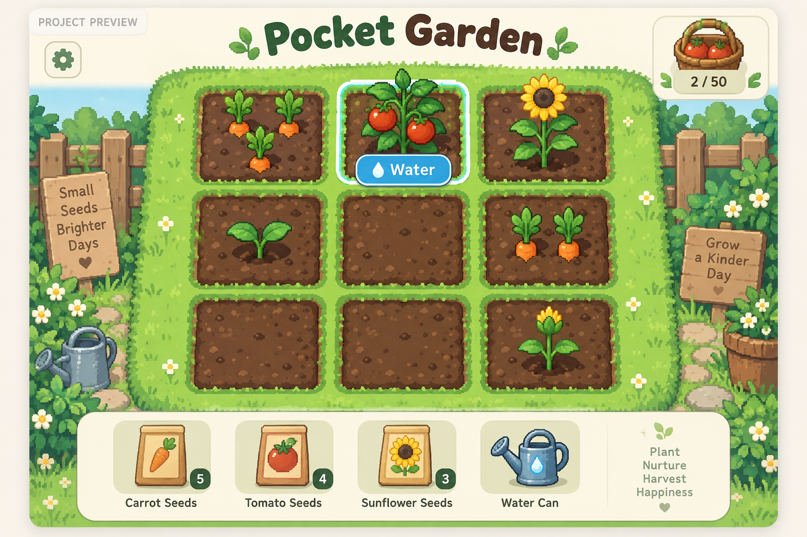
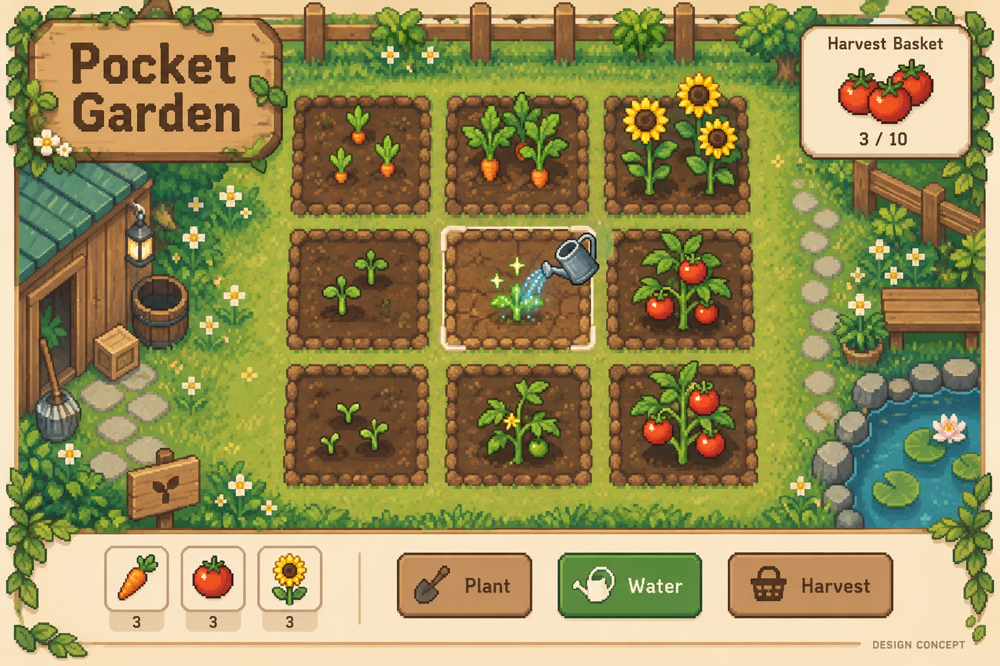
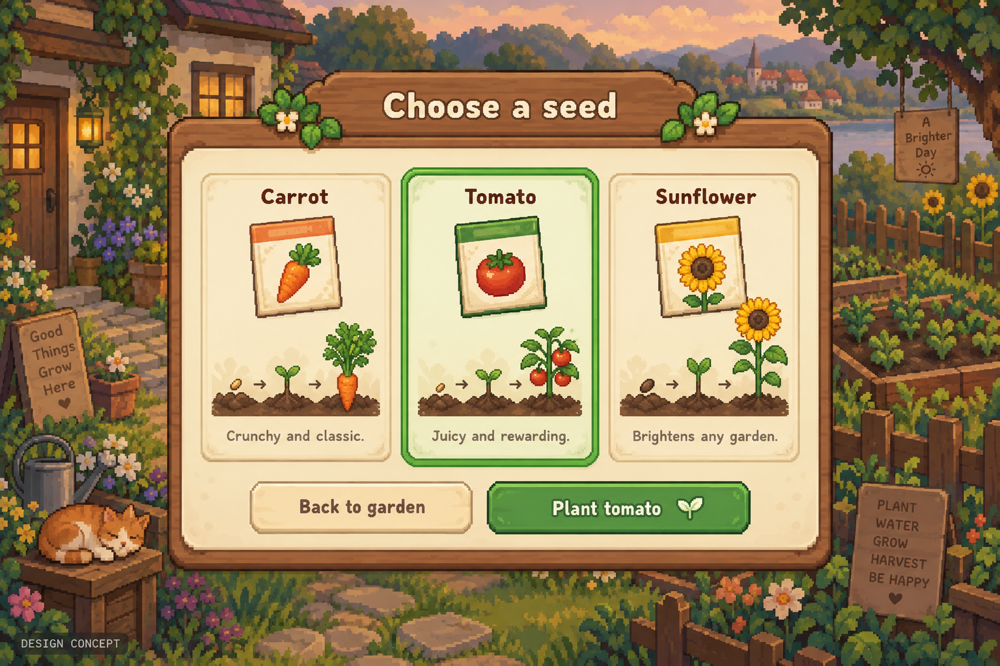

# Pocket Garden

Build a small browser gardening game with a clear plant, water and harvest loop.

> Planning-stage project. The artwork below consists of AI-generated design concepts with synthetic content; it is not a screenshot of working software or a commitment to every pictured feature.

## First milestone

A playable nine-plot garden with carrots, tomatoes and sunflowers, visible growth stages and a harvest basket.

## Starting work

- [ ] Define the first growth and watering rules.
- [ ] Create seed, plant-stage, soil and tool assets.
- [ ] Implement planting, watering, growth and harvesting.
- [ ] Test the core loop and make controls usable with a keyboard.

Use GitHub Issues for actionable work and discussion, and pull requests for reviewable changes. Repository access and merge authority follow this repository's GitHub permissions. Joining a Karma42 project does not grant repository write access. No live agent execution is started by creating this repository.

## Design concepts

### Watering and the core game loop

### Choosing a seed and seeing its growth stages

## Artwork and open choices

Generated with the built-in image generator. See [the prompts and provenance](assets/prompts.json). Generated examples, reference layers, names, counts and observations are illustrative. The owner has not yet selected a source-code or asset license; no license grant is added by this initial repository setup.

## Status

Project brief and artwork only. Runnable implementation, hosting and friend participation remain future work. Creating this repository does not resume the paused friends cloud experiment.

---

Initial project brief and artwork prepared with AI assistance for the Karma42 owner, 10 October 2026.
